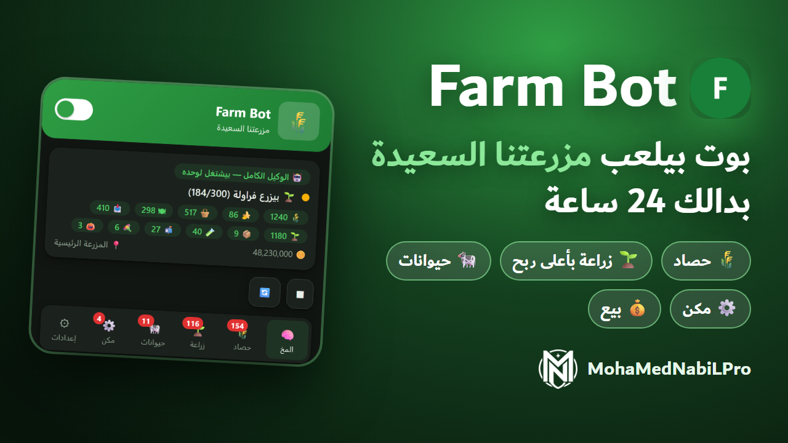
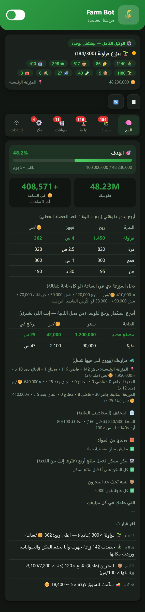
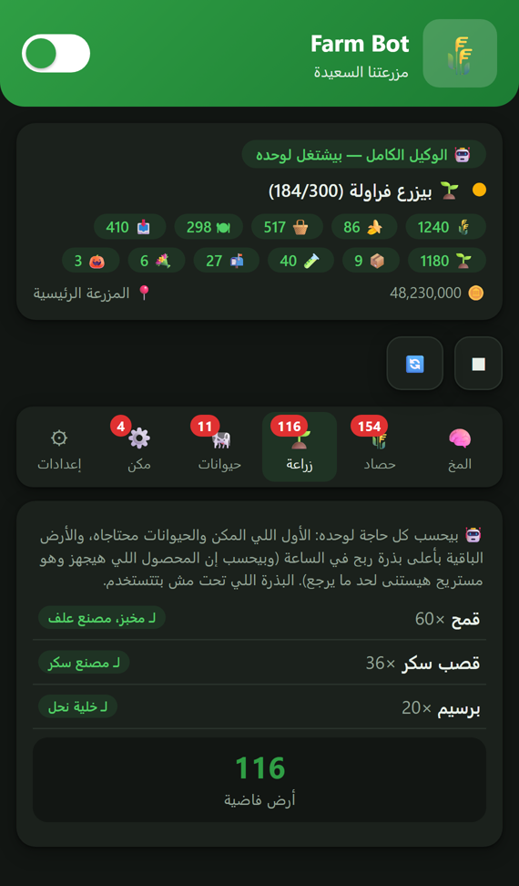
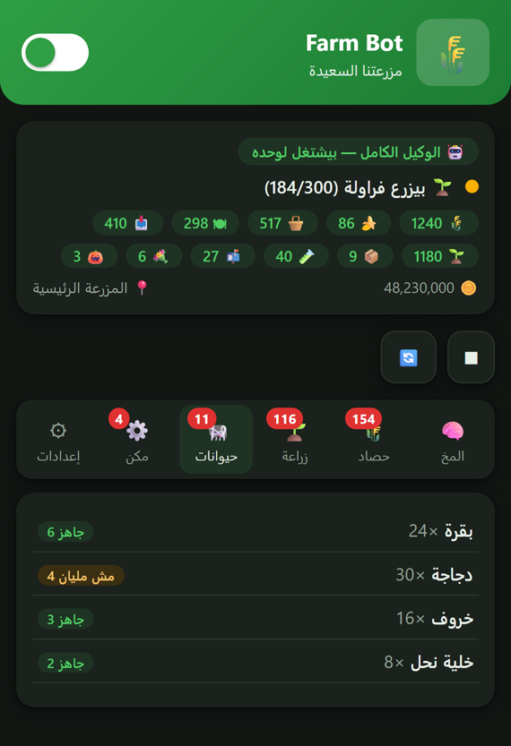
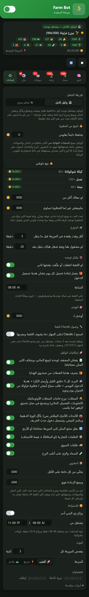

# Farm Bot 🌾: وكيل مزرعتنا السعيدة

إضافة كروم **مجانية** بتلعب **مزرعتنا السعيدة (Family Farm)** على فيسبوك لوحدها، طول ما اللعبة مفتوحة.
مش محتاجة أي برنامج تاني ولا اشتراك، والحسابات كلها بتتعمل جوه الإضافة نفسها.

## ⬇️ التحميل
**[نزّل آخر نسخة من هنا (farm-bot-extension.zip)](../../releases/latest)**

أو من فوق: **Code ← Download ZIP**.

## 🛠️ التثبيت (مرة واحدة، دقيقتين)
1. **فك الضغط** عن الملف في فولدر ثابت، مثلاً `Documents\farm-bot-extension`. ماتمسحش الفولدر بعد كده، لأن كروم بيشغّل الإضافة منه.
2. افتح كروم واكتب في شريط العنوان: `chrome://extensions`
3. شغّل **Developer mode** (المفتاح اللي فوق على اليمين).
4. اضغط **Load unpacked**، واختار الفولدر اللي فيه ملف `manifest.json`.
5. اضغط علامة البازل 🧩 جنب شريط العنوان، وثبّت **Farm Bot** عشان أيقونته 🌾 تفضل ظاهرة.

> ❗ لو ظهرت رسالة **"Manifest file is missing or unreadable"**: إنت اخترت فولدر برّه. ادخل جوّه لحد الفولدر اللي فيه `manifest.json` واختاره.

## ▶️ التشغيل
1. افتح **مزرعتنا السعيدة** على فيسبوك.
2. اعمل **F5** للصفحة مرة واحدة.
3. خلاص: الوكيل بيبدأ لوحده أول ما المزرعة تظهر. اضغط أيقونة 🌾 عشان تتابعه أو توقفه من المفتاح الأخضر اللي فوق.

## 🤖 بيعمل إيه
- **الحصاد والزراعة:** بيحصد كل اللي جهز، ويزرع مكانه على طول بالبذرة اللي بتجيب أعلى ربح في الساعة. وفي الحصاد الكبير بيزرع وهو بيحصد.
- **الحيوانات والمكن:** بيأكّل الحيوانات ويجمّع منتجاتها، ويعبّي المكن لآخره.
- **الخامات:** بيحافظ على مخزون كبير من كل خامة المكن والحيوانات محتاجاها، والخامة اللي قربت تخلص بتتزرع قبل أي حاجة.
- **البيع:** بيبيع المنتجات النهائية الزيادة، وعمره ما بيبيع خامة مكنة محتاجاها.
- **السوق والجيران:** بيسلّم طلبات السوق، ويقبل هدايا البريد، ويطلب من كل الجيران.
- **المزارع:** بيلف على مزارعك (الرئيسية والحديقة والمائية) ويروح للي فيها شغل.
- **لو اللعبة فصلت:** لو ظهرت "غير متزامنة" أو "تم تسجيل الدخول من جهاز آخر"، بيعمل ريفريش لوحده ويكمّل.
- **الهدية اليومية:** كل يوم الساعة 8 الصبح بيعمل ريفريش وياخد هدية تسجيل الدخول.
- **مابيصرفش فلوس حقيقية (RC)** خالص، ومابيستخدمش أدوات بتصرف OP.

## 📊 لوحة التحكم
الأرقام في الصور دي **توضيحية**.

| المخ | الزراعة | الحيوانات |
|---|---|---|
|  |  |  |

- **🧠 المخ:** فلوسك، ومكسبك في الساعة، وأربح بذور دلوقتي، وحالة كل مزرعة، وكل قرار البوت خده وسببه.
- **🌾 حصاد / 🌱 زراعة / 🐄 حيوانات / ⚙️ مكن:** حالة كل جزء، والبوت ناوي يزرع إيه ولمين.
- **⚙ إعدادات:** السرعة، والبيع، وساعات الشغل، والهدية اليومية، وكل ميزة تقدر تقفلها لوحدها.

صورة الإعدادات كاملة

## 💡 نصايح مهمة
- **خلّي اللعبة في شباك لوحدها ومتصغّرهوش:** كروم بيبطّأ التابات المخفية.
- **ساعات الشغل:** البوت بيرتاح تلقائيًا من 11 بالليل لـ 8 الصبح، وبياخد استراحات صغيرة زي البني آدم. لو عايزه شغال 24 ساعة، اقفل **"يرتاح زي البني آدم"** من الإعدادات.
- **جلسة واحدة بس:** اللعبة بتسمح بجهاز واحد للحساب. ماتشغّلش البوت على جهازين في نفس الوقت، وقبل ما تلعب من الموبايل وقّف البوت.
- **السرعة:** "🚀 أقصى" هي الافتراضية. لو اللعبة بتقول "غير متزامنة" كتير، اختار "⚡ سريع" أو "🐢 عادي".

## 🔄 التحديث
1. نزّل الـ ZIP الجديد، وحط ملفاته مكان القديمة في نفس الفولدر.
2. في `chrome://extensions` اضغط 🔄 على كارت Farm Bot.
3. اعمل **F5** للعبة.

## ⚠️ تنبيه
البوتات والأدوات اللي بتلعب لوحدها **ممكن تكون ضد شروط استخدام اللعبة وفيسبوك**، وده ممكن يعرّض الحساب لإيقاف أو حظر.
الإضافة مابتغيّرش ملفات اللعبة، ومابتاخدش أي حاجة ببلاش، ومابتلمسش بيانات فيسبوك. لكن مفيش أي ضمان إن الحساب مايتقفلش.
**استخدامها على مسؤوليتك.** الإضافة دي مش تبع Century Games ولا فيسبوك.

---
صنع بواسطة **MohaMedNabiLPro**
